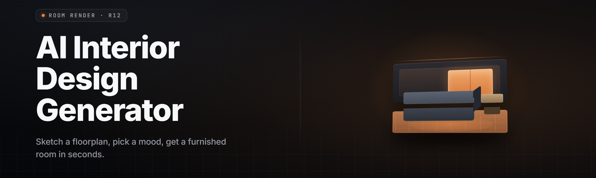

  
  
  

  

  
  
  

---

Browser tool for renters and DIY decorators — an AI interior design generator that turns room photos into layout and palette options with no subscription.

## Overview

Browser tool for renters and DIY decorators — an AI interior design generator that turns room photos into layout and palette options with no subscription.

  

## License

[MIT License](LICENSE)

  

